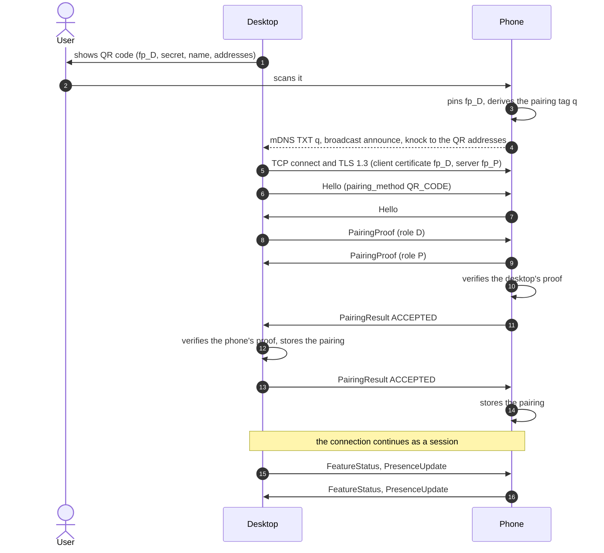
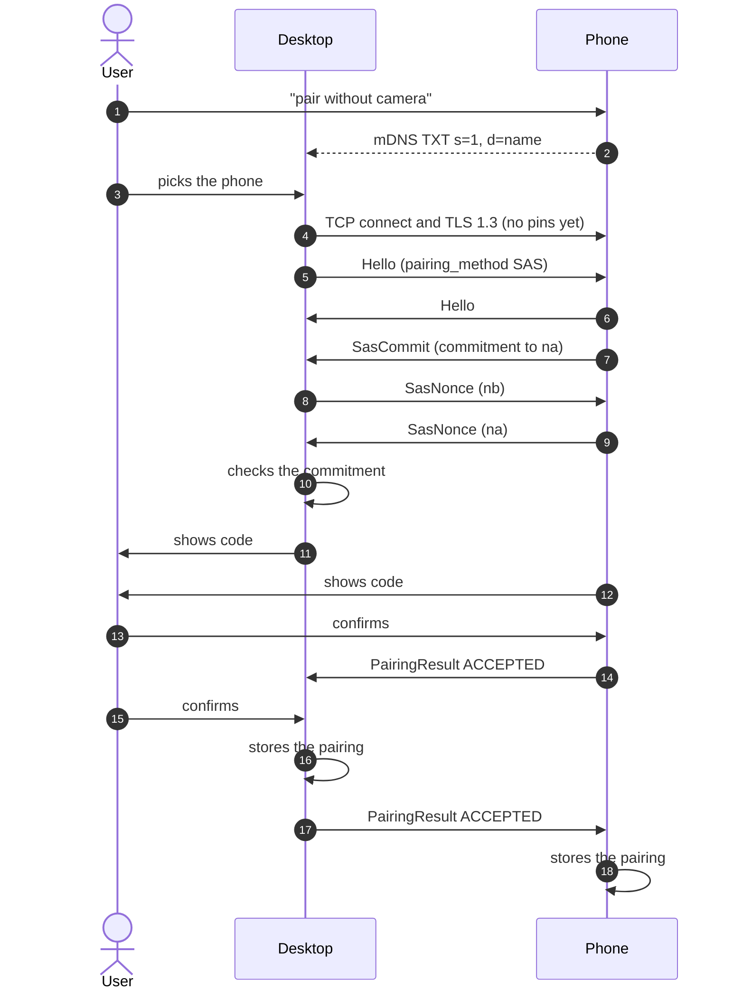
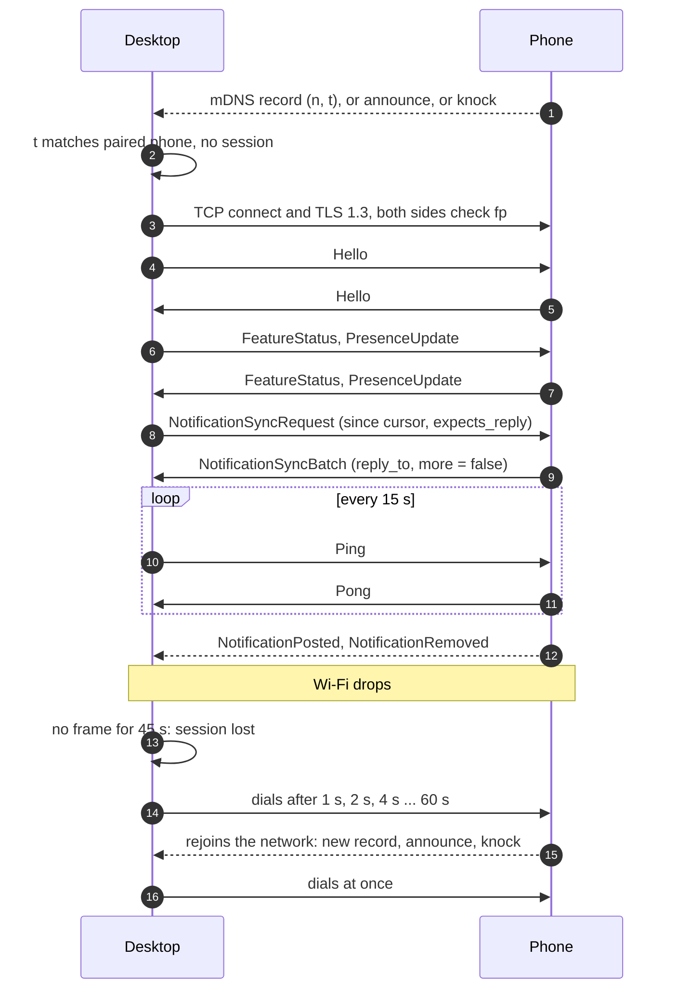

# link2linux protocol, version 1

This document specifies how the link2linux desktop app and the link2linux
Android app find each other on a local network, establish trust, and
exchange messages. The wire messages are defined once, in
[`proto/link2linux/v1`](../proto/link2linux/v1); this document gives the
rules around them. The reasons behind the main choices are in the decision
records: [pairing and trust](adr/0005-local-pairing-and-trust.md),
[discovery and dialing](adr/0006-discovery-and-dialing.md) and
[message patterns and sync](adr/0007-message-patterns-and-sync.md).

Everything stays on the local network. There is no account, no server and
no relay: the two devices talk to each other directly or not at all.

## Contents

- [Conventions](#conventions)
- [Identity](#identity)
- [Discovery](#discovery)
- [Pairing](#pairing)
- [Transport](#transport)
- [Session](#session)

## Conventions

The key words MUST, MUST NOT, SHOULD, SHOULD NOT and MAY are used as in
BCP 14 (RFC 2119, RFC 8174) when they appear in capitals.

- **Roles.** Every connection is between one *desktop* and one *phone*.
  The desktop always opens the TCP connection and is always the TLS
  client. The phone always listens.
- **Notation.** `||` is byte concatenation. Text labels in cryptographic
  inputs are ASCII bytes with no terminator. Integers in cryptographic
  inputs are big-endian.
- **Fingerprints.** `fp(X)` is the SHA-256 hash of device X's public key,
  computed over the DER encoding of the certificate's
  SubjectPublicKeyInfo. It is 32 bytes. `fp_D` is the desktop's, `fp_P`
  the phone's.
- **base64url** is RFC 4648 section 5, without padding.
- **Times** on the wire are Unix time in milliseconds, in `int64` fields
  named `*_unix_ms`.
- **Text** is UTF-8. Lengths and limits are in bytes.
- **Enum values** are written without their type's prefix where the type
  is clear: `READY` stands for `FEATURE_AVAILABILITY_READY`.

### Constants

| Name | Value |
|---|---|
| mDNS service type | `_link2linux._tcp.local.` |
| Phone TCP port (default) | 47474 |
| Discovery UDP port | 47474 |
| Discovery datagram magic | `L2LD` (0x4C 0x32 0x4C 0x44) |
| Bluetooth LE service UUID | `d0135d8c-397d-4afe-b65f-bb4c33308f6d` |
| TLS ALPN protocol ID | `link2linux` |
| TLS exporter label | `EXPORTER-link2linux-pairing-v1` |
| QR code URI | `link2linux://pair?...` |
| Maximum frame body | 4 MiB |
| Maximum image size | 1 MiB |
| Protocol major version | 1 |

## Identity

Each installation of either app has:

- a **device id**: a random UUID, written in lowercase hyphenated form,
  created on first run and kept until the app's data is cleared;
- a **device name**: shown to the other device, at most 64 bytes, chosen by
  the user and defaulting to the host or model name;
- an **identity key**: an ECDSA P-256 key pair, created on first run, and
  a self-signed X.509 certificate for it.

The desktop keeps its private key in the Secret Service keyring when one is
available, and otherwise in a file only the user can read (mode 0600). The
phone keeps its private key in the Android Keystore, where it cannot be
exported.

Peers recognize each other by `fp`, never by anything else in the
certificate: names, validity dates and extensions are ignored. A device can
therefore reissue its certificate for the same key at any time, for example
when it expires, without affecting its peers.

A **pairing record** is what a device stores about a peer it trusts: the
peer's device id, name, kind, current `fp`, an optional next `fp` (see
[key rotation](#key-rotation)), and the time of pairing. A desktop also
stores the phone's presence key and last known addresses; a phone stores
the desktop's Bluetooth LE address and last known addresses.

## Discovery

The phone listens for connections and makes itself findable. The desktop
looks for phones and dials them. The desktop never needs an open inbound
port, so a desktop firewall that blocks inbound connections, which is
common, does not get in the way.

The phone listens on TCP port 47474. If that port is taken it MAY listen on
any other port, which it then advertises. It listens while its connection
service runs, which is whenever it has a pairing (or a pairing is under
way) and is on a Wi-Fi or Ethernet network, unless the user turned
link2linux off.

The desktop learns where a phone is from four sources, all of them hints
that only ever lead to a dial attempt. Trust comes from TLS alone.

1. **mDNS / DNS-SD** announcements from the phone.
2. **UDP datagrams** from the phone: broadcast announcements, and unicast
   *knocks* sent to the desktop's last known addresses.
3. **Last known addresses** from earlier sessions.
4. **An address the user types**, as a last resort.

### mDNS

The phone registers one service of type `_link2linux._tcp` on every
Wi-Fi or Ethernet interface. The SRV record carries its TCP port; the A and
AAAA records carry its addresses. The instance name is `l2l-` followed by 8
random hex digits, picked anew together with the presence nonce below, so
the name says nothing about the phone.

TXT keys (unknown keys MUST be ignored):

| Key | Value | When |
|---|---|---|
| `v` | Highest protocol major version, in decimal | Always |
| `n` | Presence nonce: 8 random bytes, base64url | When the phone has at least one pairing |
| `t` | Presence tag, base64url (see below) | With `n` |
| `q` | Pairing tag of the scanned QR code, base64url | While waiting for the desktop after a QR scan |
| `s` | `1` | While the phone is in SAS pairing mode |
| `d` | The phone's device name | Only in SAS pairing mode |

The **presence tag** lets a paired desktop recognize its phone while
everyone else sees only random values:

```
t = first 8 bytes of HMAC-SHA256(presence_key, "link2linux presence v1" || n)
```

`presence_key` is 32 random bytes that the phone creates once and gives to
each paired desktop in `PresenceUpdate`. The phone picks a fresh nonce, and
with it a fresh instance name, whenever it joins a network and at least
every 15 minutes. A desktop checks a record against each paired phone's key;
the cost is one HMAC per paired phone.

The **pairing tag** lets the desktop that showed a QR code find the phone
that scanned it, without putting the secret on the network:

```
q = first 8 bytes of HMAC-SHA256(secret, "link2linux pairing tag v1")
```

The desktop browses with its own mDNS implementation, so it does not depend
on a system mDNS daemon. On Android, the phone uses the platform's
network service discovery and holds a multicast lock only while it needs to
receive multicast.

### Discovery datagrams

Some networks drop multicast but pass broadcast and unicast. For those, the
phone and the desktop also exchange small UDP datagrams on port 47474:

```
datagram = "L2LD" || kind (1 byte) || entries
entries  = zero or more of: length (1 byte) || "key=value" (length bytes)
```

The entries use the DNS TXT encoding and the same keys as the mDNS TXT
record, plus `port` (the phone's TCP port, in decimal) in announcements. A
datagram is at most 512 bytes. Receivers ignore unknown kinds and keys.

| Kind | Name | Sent by | Sent to |
|---|---|---|---|
| 1 | announce | phone | The broadcast address of each interface, and, as a *knock*, the desktop's known addresses |
| 2 | probe | desktop | The broadcast address of each interface |

- Both sides listen on UDP port 47474.
- The phone broadcasts an announce when it joins a network; every 2
  seconds for 30 seconds after a QR scan and after SAS pairing mode starts;
  and in answer to a probe, at most once per second, by sending its
  announce to UDP port 47474 of the probing address. A reply to the probe's
  source port would not get through: a desktop firewall does not match a
  unicast reply to a broadcast it sent.
- The phone also *knocks*: it sends its announce by unicast to UDP port
  47474 of each address in the QR code (on the same schedule as the
  broadcasts after a scan), and of each paired desktop's last known
  addresses (when it joins a network or its connection service starts). A
  knock reaches a desktop whose firewall allows this one UDP port even
  where broadcast and multicast are filtered.
- The desktop sends bursts of 5 probes, 2 seconds apart, when it starts,
  when its network changes, when a session is lost, when the pairing screen
  opens and when the user asks to reconnect. It does not probe
  periodically.

### Choosing what to dial

The desktop dials a phone when a record or datagram shows:

- a presence tag that matches a paired phone with no live session;
- the pairing tag of the QR code the desktop is showing; or
- SAS pairing mode, for a phone the user picked from the list.

It dials only addresses that are on-link for one of its own interfaces: in
an IPv4 subnet of one of its interfaces, IPv6 link-local, or in an IPv6
/64 prefix of one of its interfaces. It dials an IPv6 link-local address on
the interface where it learned it. This keeps a forged announcement from
steering the desktop towards arbitrary hosts. It also dials the last known
addresses of a paired phone when it starts, when its network changes and on
the reconnect schedule (see [Transport](#transport)). An address the user
types is dialed as given.

### Bluetooth LE

The desktop MAY advertise the link2linux service UUID over Bluetooth LE.
No data flows over Bluetooth in version 1. The advertisement exists so that
the phone can create a companion-device association with the desktop and
ask Android to watch for its presence. Android then starts the phone app
when the desktop comes near, and exempts it from some background limits
while the desktop is present, which keeps the connection service alive
without the phone polling.

- Advertising data: the 128-bit service UUID. Scan response: the desktop's
  device name, truncated to fit, so the system's association dialog can
  show it.
- The desktop advertises from a stable address and tells the phone that
  address in `PresenceUpdate.ble_address`. The phone uses it as the filter
  of its association request, so the dialog offers exactly that desktop.
- The phone treats a presence event only as a reason to start listening
  and announcing. It never treats one as proof of anything.

Bluetooth is optional on both sides. Without it, the phone relies on its
foreground connection service alone.

### Android local network access

Apps that target Android API 37 or later need the `ACCESS_LOCAL_NETWORK`
runtime permission for everything in this section: listening for TCP,
mDNS, and UDP broadcast and unicast. The version 1 phone app targets API 36
and does not need it. The app that targets API 37 asks for it during
onboarding, next to the other nearby-device permissions.

## Pairing

Pairing makes two devices trust each other's identity keys. It always runs
on a TLS connection that the desktop dials, like any other connection, and
the connection continues as a normal session once pairing succeeds.

The desktop starts a pairing. It offers two methods:

1. **QR code** (default). The desktop shows a QR code that carries its
   fingerprint and a one-time secret. The phone scans it, so the phone
   knows the desktop's key before they connect, and both sides prove that
   they know the secret.
2. **SAS** (fallback, for a phone that cannot scan). Both screens show a
   six-digit code derived from the connection, and the user confirms on
   both that they match.

### QR code payload

The QR code holds a URI, encoded in byte mode with error correction level
M:

```
link2linux://pair?v=1&f=<fp_D>&s=<secret>&n=<name>&a=<addresses>
```

| Parameter | Content |
|---|---|
| `v` | Payload format version: `1`. A phone that does not know the version asks the user to update the app. |
| `f` | `fp_D`, base64url (43 characters). |
| `s` | The one-time secret: 16 random bytes, base64url (22 characters). |
| `n` | The desktop's device name, percent-encoded, at most 64 bytes before encoding. Shown on the phone before it connects. |
| `a` | Up to 4 of the desktop's addresses, comma-separated, for knocks: an IPv4 address or an IPv6 address, each optionally with `:port` (IPv6 in brackets then). The default port is 47474. |

Unknown parameters MUST be ignored, so later versions can add some. A
typical payload is about 160 characters long.

The desktop creates a new secret each time it shows a code. An offer is
valid for 5 minutes and for one successful pairing; after 5 failed proofs
the desktop withdraws it and shows a new code. The phone does not need the
expiry: the desktop enforces it.

### Certificate checks

These rules decide which certificates each side accepts, on every
connection. The phone accepts a client certificate when any of these
holds:

- its `fp` is the current or next `fp` of a paired desktop;
- a QR offer is active, and its `fp` equals `f` from the QR code;
- SAS pairing mode is on (one connection at a time).

The desktop accepts the phone's certificate when:

- it dialed a paired phone, and the `fp` is that phone's current or next
  `fp`; or
- it dialed to pair. It then accepts any key and records `fp_P`.

The signature in the TLS CertificateVerify message MUST be verified in
every case, so that the peer proves it holds the private key.

The desktop sets `Hello.pairing_method` on a pairing connection, even when
it already has a record for the phone. The phone checks that it expects
that method from this desktop: a QR offer whose `f` is the desktop's `fp`,
or SAS mode. If it does not, it sends `PairingResult` with
`PAIRING_OUTCOME_NOT_EXPECTED` and closes the connection. A connection
whose Hello sets no pairing method is a normal session, which the phone
closes unless the desktop is paired.

### QR code handshake

After the Hello exchange, both sides derive the same 32-byte value from the
TLS connection with the keying material exporter (RFC 8446 section 7.5):

```
ekm = TLS-Exporter("EXPORTER-link2linux-pairing-v1", empty context, 32)
```

In TLS 1.3, an absent context and an empty one give the same value.

Each side then sends a `PairingProof`:

```
mac = HMAC-SHA256(secret,
        "link2linux pairing proof v1" || role || ekm || fp_D || fp_P)
role = 0x44 ("D") in the desktop's proof, 0x50 ("P") in the phone's
```

`fp_D` and `fp_P` are the fingerprints of the certificates presented in this
TLS connection. Each side recomputes the peer's expected `mac` and compares
in constant time. On a mismatch it sends `PairingResult` with
`PAIRING_OUTCOME_VERIFICATION_FAILED` and closes the connection.



The QR method needs no comparison by the user: scanning the code is the
user's consent on both devices, and the code is only on the desktop's
screen.

### SAS pairing

The user turns on "pair without camera" on the phone. For the next 2
minutes, the phone accepts one pairing connection at a time from any
desktop, and advertises `s=1` and its name. The desktop lists such phones,
the user picks one, and the desktop dials it with
`Hello.pairing_method = PAIRING_METHOD_SAS`. Then, with `ekm` as above:

1. The phone picks a 32-byte random nonce `na` and sends `SasCommit`:
   `commitment = SHA-256("link2linux sas commit v1" || ekm || fp_D || fp_P || na)`.
2. Once the commitment has arrived, the desktop picks a 32-byte random
   nonce `nb` and sends it in `SasNonce`.
3. Once `nb` has arrived, the phone sends `na` in `SasNonce`.
4. The desktop checks the commitment. On a mismatch it sends
   `PAIRING_OUTCOME_VERIFICATION_FAILED` and closes the connection.
5. Both devices show the code, formatted as two groups of three digits:

   ```
   h   = SHA-256("link2linux sas v1" || ekm || fp_D || fp_P || na || nb)
   sas = (first 4 bytes of h, as an unsigned integer) mod 1000000
   ```

6. The user confirms on each device that the codes match, or declines.
   Each device then sends `PairingResult` in the order described in
   [Storing the pairing](#storing-the-pairing).



The commitment is what makes six digits enough. An attacker in the middle
runs two TLS connections, one with each device, and needs both screens to
show the same code. Without the commitment it could try many keys or
nonces offline until the codes collide, which takes seconds for a
million-value code. With it, the phone's nonce is fixed before the desktop's
nonce is known, and the phone reveals it only after receiving the desktop's
nonce, so the attacker has to commit to its own values blindly on at least
one of the two connections. One attempt then succeeds with probability
10^-6, and each attempt needs the user to confirm a code.

The phone leaves SAS mode after a successful pairing, after 2 minutes, or
after 3 failed or declined attempts. Each device gives the user 60 seconds
to confirm, then sends `PAIRING_OUTCOME_TIMED_OUT`.

### Storing the pairing

`PAIRING_OUTCOME_ACCEPTED` goes in a fixed order, so the desktop stores
the pairing first:

1. The phone sends `ACCEPTED` once it has verified the desktop (QR: the
   desktop's proof; SAS: the user confirmed).
2. The desktop stores the pairing once it has verified the phone and
   received the phone's `ACCEPTED`, then sends its own `ACCEPTED`.
3. The phone stores the pairing when the desktop's `ACCEPTED` arrives.

Any other outcome may be sent by either side at any time; the sender then
closes the connection, and neither side stores anything.

If the connection drops between steps 2 and 3, only the desktop has a
record. The desktop therefore marks a new record as unconfirmed until the
phone's first `FeatureStatus` arrives, which the phone sends only after
storing the pairing. When the phone rejects the desktop's certificate on a
later dial, the desktop deletes an unconfirmed record and asks the user to
pair again; for a confirmed record, it tells the user that the phone
removed the pairing.

### Phones without a TLS exporter

Android exposes the keying material exporter from API level 31
(`SSLSockets.exportKeyingMaterial`). The phone app supports API 26 and
later, and the platform TLS stack below API 29 has no TLS 1.3 at all. Below
API 31 the app therefore uses a bundled Conscrypt provider for its TLS
connections, which brings TLS 1.3 and an exporter.

A phone that still cannot export keying material MUST NOT pair: it sends
`PAIRING_OUTCOME_UNSUPPORTED` and tells the user to update the app. It MUST
NOT fall back to proofs without `ekm`. Binding to the connection is what
keeps a proof or a code from being relayed into another connection if a
certificate check is ever implemented wrongly.

### Re-pairing

Pairing again with a device that already has a record replaces that
record, including its keys and presence key. A phone that scans a QR code
whose `f` matches a paired desktop re-pairs with it, and a phone in SAS
mode re-pairs with a paired desktop that dials it to pair: the method in
the desktop's Hello decides, not the old record.

Clearing an app's data creates a new device id and key. The other device
then keeps a stale record until the user removes it; the desktop shows when
each phone was last connected to help with that.

### Unpairing

Either user can remove a pairing at any time.

- If a session is up, the side that removes it sends `Goodbye` with
  `GOODBYE_REASON_UNPAIRED`, deletes its record and closes the connection.
  The receiver deletes its record too.
- If no session is up, the side deletes its record. When the phone removed
  it, the desktop finds out on its next dial, which the phone rejects, and
  offers to remove its own record. When the desktop removed it, the phone
  cannot tell that from a desktop that is switched off; it shows when each
  desktop last connected, so the user can remove stale ones.

A phone that removes a pairing also picks a new presence key and sends it
to its remaining desktops in their next sessions, so the removed desktop
can no longer recognize its announcements.

### Key rotation

A device can replace its identity key without pairing again:

1. During a session, it sends `KeyRotation` with the fingerprint of the
   next key. The peer stores it as the next `fp` and answers with `Ack`.
2. On later connections, the device uses the new key. The peer accepts
   either the current or the next `fp`. After the first successful
   connection with the next key, it makes that key current and forgets the
   old one.

A device that loses its private key, for example because the Android
Keystore was reset, has to pair again.

## Transport

### TLS

Every connection is TLS 1.3 over TCP, with certificates on both sides.

- TLS 1.2 and earlier MUST NOT be negotiated.
- The desktop is the TLS client. It connects to an IP address and sends no
  server name indication.
- Both sides send the ALPN protocol ID `link2linux`; the phone rejects
  connections that do not.
- The phone requests a client certificate and rejects a connection without
  one.
- Certificates use ECDSA P-256 keys. Both sides MUST support the
  `ecdsa_secp256r1_sha256` signature scheme.
- Session resumption and 0-RTT data MUST NOT be used: every connection runs
  a full handshake, so every connection proves possession of both keys, and
  no data can be replayed.
- Peer certificates are checked as in [Certificate
  checks](#certificate-checks): by `fp` alone, after verifying the
  CertificateVerify signature.

### Framing

Each frame is a varint holding the length of one serialized `Envelope`,
followed by that many bytes, the same format as protobuf's length-delimited
streams. A frame body MUST NOT exceed 4 MiB. A receiver that sees a larger
length or an undecodable body closes the connection, because the stream is
out of sync.

Senders SHOULD keep frames below 256 KiB, splitting large answers into
batches, so that a `Ping` never waits long behind a bulk frame.

### Connecting and reconnecting

The desktop keeps trying to have one session with each paired phone that
is not marked as disconnected by the user. It dials when:

- it starts, resumes from sleep, or its network changes;
- an mDNS record, announce or knock matches a paired phone with no live
  session;
- a session ends, following the backoff below;
- the user asks to reconnect.

A dial attempt races all candidate addresses for the phone (from mDNS, the
datagram's source, and the last known addresses), starting a new TCP
connection every 250 ms until one succeeds. The first connection that
completes TLS with the expected key wins; the others are closed. TCP
connect times out after 5 seconds, the TLS handshake after 10 seconds and
the Hello exchange after 10 seconds.

When an attempt fails, or a session ends without a `Goodbye` that says
otherwise, the desktop waits before the next attempt:

| Attempt | 1 | 2 | 3 | 4 | 5 | 6 | 7 and later |
|---|---|---|---|---|---|---|---|
| Delay | 1 s | 2 s | 4 s | 8 s | 16 s | 32 s | 60 s |

Each delay varies randomly by up to 20 % either way. The schedule restarts
at attempt 1 when the desktop's network changes, when it resumes from
sleep, and after a session that lasted more than a minute. New discovery
evidence for the phone (a matching record, announce or knock) triggers an
attempt at once, but never more than one attempt per phone every 2
seconds.

The desktop shows the phone as "reconnecting" for the first 2 minutes
after a session ends, then as "disconnected", while it keeps trying.



### Liveness

The desktop drives liveness, because it is awake anyway and a phone that
only answers can let its radio sleep.

- The desktop sends a `Ping` every 15 seconds. It MAY use any interval
  from 5 to 60 seconds. If nothing at all arrives from the phone for 3
  intervals, it considers the session lost.
- The phone answers every `Ping` with a `Pong` carrying the same nonce, and
  never sends a `Ping` of its own. If nothing arrives from the desktop for
  180 seconds, it considers the session lost.
- Any frame counts as a sign of life, not only `Pong`.

### One session per pair

A desktop and a phone have at most one session with each other. When a new
connection from a paired desktop completes its Hello exchange while an
older session with that desktop is still open, the phone sends `Goodbye`
with `GOODBYE_REASON_REPLACED` on the old connection and closes it. This
resolves half-open connections left over after a network change. A phone
MAY have sessions with several desktops at the same time.

## Session

### Start

Each side sends `Hello` as its first envelope, with `seq` 1, without
waiting for the peer's. Each side reads the peer's `Hello` before anything
else; any other first message is a protocol error. A `Hello` later in the
session is a protocol error too.

On a pairing connection, pairing follows the Hello exchange (see
[Pairing](#pairing)). Otherwise, and after pairing succeeds, each side sends
`FeatureStatus` and then `PresenceUpdate`. After that, both sides may send
any message of the features that are active in the session.

### Version negotiation

`Hello.protocol_version` is the highest protocol major version the sender
speaks, and `Hello.min_protocol_version` the lowest (0 means the same as
the highest). The session uses the highest version both ranges contain.
Both sides compute it from the two Hellos, so they agree without another
round trip. If the ranges do not overlap, each side sends `Goodbye` with
`GOODBYE_REASON_VERSION_MISMATCH`, closes the connection, and tells the
user which app to update.

Some fields keep their numbers and meaning in every major version, so that
the two Hellos and that Goodbye can always be read: Envelope fields 1 to 3,
the Envelope payloads `hello` (10) and `goodbye` (13), Hello fields 1 to 7,
and all of Goodbye.

### Capabilities

`Hello.features` lists capability tokens, the parts of the protocol the
sender's build implements:

- a feature name: `notifications`, `messages`, `calls`, `photos`, `files`,
  `clipboard` or `screen`;
- an optional part of a feature, written `feature.option`. Version 1
  defines none; later versions add options this way instead of changing
  the meaning of existing messages.

A feature is **active** in a session when both Hellos list it. An option is
active when both list it and its feature is active. Tokens a side does not
know are ignored. A change that existing peers would misread gets a new
token, for example `notifications2`, rather than a version number.

`FeatureStatus` adds what the build cannot know: whether the feature can be
used right now on the device. Each side sends a complete `FeatureStatus`
after Hello and a new complete one whenever a state changes:

| Availability | Meaning | What the other side shows |
|---|---|---|
| `READY` | Usable | The feature |
| `DISABLED` | The user turned it off on that device | "Turned off on your phone" (or desktop) |
| `PERMISSION_REQUIRED` | An OS permission is missing; `permission` says which | A setup hint for that permission |
| `UNAVAILABLE` | The device cannot offer it, e.g. a phone without telephony | Nothing, or "Not available" |

A side only sends a feature's requests while the feature is active and
`READY` on both sides. Version 1 defines one permission token,
`notification-access` (the phone's notification listener access). Each
feature section defines its own.

### Sequence numbers

`Envelope.seq` starts at 1 with `Hello` and grows by exactly one with each
envelope the side sends. A receiver checks that each `seq` is greater than
the previous one; anything else is a protocol error. Sequence numbers start
again at 1 on every connection.

### Unknown and unexpected messages

The schema grows over time, so each side meets messages it does not know.

- **Unknown payload** (the Envelope's `payload` is empty after decoding):
  if `expects_reply` is set, answer with `ErrorReply` and
  `ERROR_CODE_UNSUPPORTED`; otherwise ignore it.
- **Unknown fields** in a known message are ignored.
- **Unknown enum values** are handled like the enum's zero value, unless
  the field's documentation says otherwise.
- **A request of a feature that is not active**: answer with
  `ERROR_CODE_UNSUPPORTED`. A one-way message of such a feature is
  ignored.
- **A reply nobody waits for** (a `reply_to` that matches no open request,
  for example one that timed out): ignore it.
- **A message in the wrong place** (pairing messages in a normal session,
  feature messages during pairing, a second `Hello`, a reply that the
  request type does not allow): a protocol error.

On a protocol error the side MAY send an `ErrorReply` with `reply_to` 0
describing it, then sends `Goodbye` with `GOODBYE_REASON_PROTOCOL_ERROR`
and closes the connection.

### Ending a session

A side that closes a connection on purpose first sends `Goodbye`. Its
reason decides what happens next:

| Reason | Receiver's action |
|---|---|
| `SHUTDOWN` | Desktop reconnects with the usual backoff. |
| `USER_DISCONNECT` | No reconnect until the user reconnects on the device that sent it. A phone that sends it stops listening and announcing until then. |
| `UNPAIRED` | Delete the pairing record. |
| `REPLACED` | Nothing: a newer session already exists. |
| `PROTOCOL_ERROR` | Log it; the desktop reconnects with backoff. |
| `VERSION_MISMATCH` | No reconnect until one app is updated. |
| `UNSPECIFIED` or none | As for a lost connection. |
