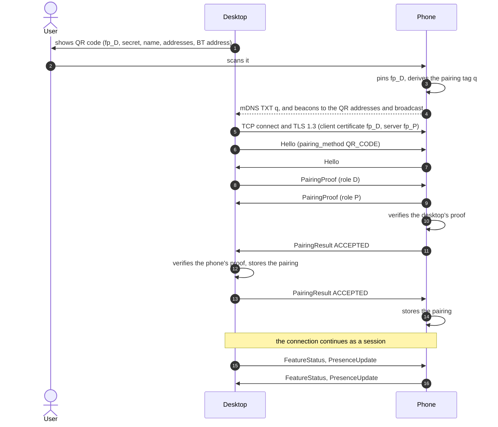
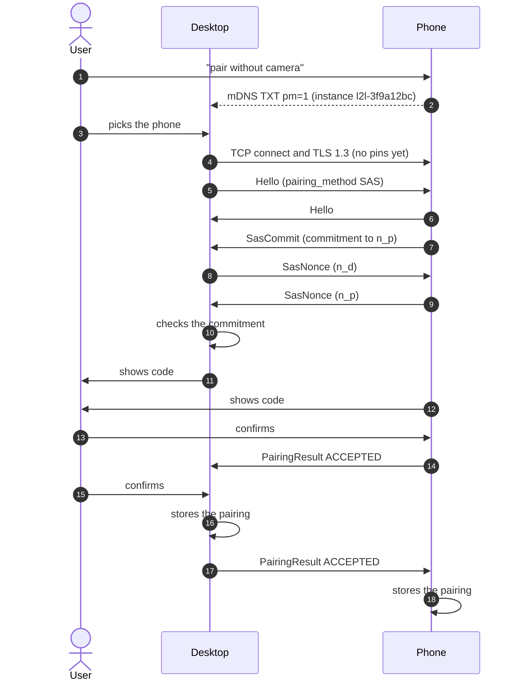
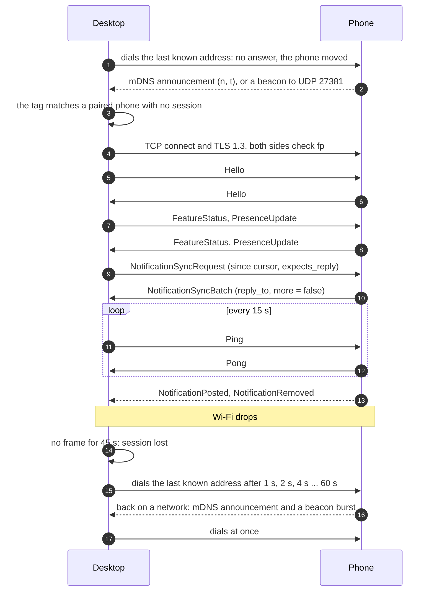

# link2linux protocol, version 1

This document specifies how the link2linux desktop app and the link2linux
Android app find each other on a local network, establish trust, and
exchange messages. The wire messages are defined once, in
[`proto/link2linux/v1`](../proto/link2linux/v1); this document gives the
rules around them. The reasons behind the main choices are in the decision
records: [pairing and trust](adr/0005-local-pairing-and-trust.md),
[discovery and dialing](adr/0006-discovery-and-dialing.md) and
[message patterns and sync](adr/0007-message-patterns-and-sync.md).

Everything stays on the local network. There is no account, no server and
no relay: the two devices talk to each other directly or not at all.

## Contents

- [Conventions](#conventions)
- [Identity](#identity)
- [Discovery](#discovery)
- [Pairing](#pairing)
- [Transport](#transport)
- [Session](#session)
- [Message patterns](#message-patterns)
- [Errors](#errors)
- [Notifications](#notifications)
- [Security considerations](#security-considerations)
- [Versioning](#versioning)
- [Message index](#message-index)

## Conventions

The key words MUST, MUST NOT, SHOULD, SHOULD NOT and MAY are used as in
BCP 14 (RFC 2119, RFC 8174) when they appear in capitals.

- **Roles.** Every connection is between one *desktop* and one *phone*.
  The desktop always opens the TCP connection and is always the TLS
  client. The phone always listens.
- **Notation.** `||` is byte concatenation. Text labels in cryptographic
  inputs are ASCII bytes with no terminator. Integers in cryptographic
  inputs are big-endian.
- **Fingerprints.** `fp(X)` is the SHA-256 hash of device X's public key,
  computed over the DER encoding of the certificate's
  SubjectPublicKeyInfo. It is 32 bytes. `fp_D` is the desktop's, `fp_P`
  the phone's.
- **base64url** is RFC 4648 section 5, without padding.
- **Times** on the wire are Unix time in milliseconds, in `int64` fields
  named `*_unix_ms`.
- **Text** is UTF-8. Lengths and limits are in bytes.
- **Enum values** are written without their type's prefix where the type
  is clear: `READY` stands for `FEATURE_AVAILABILITY_READY`.

### Constants

| Name | Value |
|---|---|
| mDNS service type | `_link2linux._tcp.local.` |
| Phone TCP port (default) | 27380 |
| Beacon UDP port (desktop listens) | 27381 |
| Beacon magic | `L2LB` (0x4C 0x32 0x4C 0x42) |
| Bluetooth LE service UUID | `d0135d8c-397d-4afe-b65f-bb4c33308f6d` |
| TLS ALPN protocol ID | `l2l/1` |
| TLS exporter label, QR pairing | `EXPERIMENTAL-link2linux-pair-v1` |
| TLS exporter label, SAS pairing | `EXPERIMENTAL-link2linux-sas-v1` |
| QR code URI | `link2linux://pair?...` |
| Maximum frame body | 4 MiB |
| Maximum image size | 1 MiB |
| Protocol major version | 1 |

## Identity

Each installation of either app has:

- a **device id**: a random UUID, written in lowercase hyphenated form,
  created on first run and kept until the app's data is cleared;
- a **device name**: shown to the other device, at most 64 bytes, chosen by
  the user and defaulting to the host or model name;
- an **identity key**: an ECDSA P-256 key pair, created on first run, and
  a self-signed X.509 certificate for it.

The desktop keeps its private key in the Secret Service keyring when one is
available, and otherwise in a file only the user can read (mode 0600). The
phone keeps its private key in the Android Keystore, where it cannot be
exported.

Peers recognize each other by `fp`, never by anything else in the
certificate: names, validity dates and extensions are ignored. A device can
therefore reissue its certificate for the same key at any time, for example
when it expires, without affecting its peers.

A **pairing record** is what a device stores about a peer it trusts: the
peer's device id, name, kind, current `fp`, an optional next `fp` (see
[key rotation](#key-rotation)), and the time of pairing. A desktop also
stores the phone's presence key and last known addresses; a phone stores
the desktop's Bluetooth LE address and last known addresses.

## Discovery

The phone listens for connections and makes itself findable. The desktop
looks for phones and dials them. The desktop never needs an open inbound
TCP port, so a desktop firewall that blocks inbound connections, which is
common, does not get in the way.

The phone listens on TCP port 27380. If that port is taken it MAY listen on
any other port, which it then advertises. It listens while its connection
service runs, which is whenever it has a pairing (or a pairing is under
way) and is on a Wi-Fi or Ethernet network, unless the user turned
link2linux off.

Discovery only ever flows from the phone to the desktop. A phone whose app
is in the background does not receive multicast or broadcast traffic:
Android drops it in the Wi-Fi firmware unless the app holds a multicast
lock, which costs battery. So the desktop never asks; the phone announces
itself, and the desktop listens.

The desktop learns where a phone is from these sources, all of them hints
that only ever lead to a dial attempt. Trust comes from TLS alone.

1. **The last known address** (IP and port) of each paired phone, from its
   last session. The desktop tries it first.
2. **mDNS / DNS-SD** announcements from the phone.
3. **Beacons**: small UDP datagrams the phone sends to the desktop, for
   networks that filter multicast.
4. **An address the user types**, as a last resort.

### mDNS

The phone registers one service of type `_link2linux._tcp` on every
Wi-Fi or Ethernet interface. The SRV record carries its TCP port; the A and
AAAA records carry its addresses. The instance name is `l2l-` followed by 8
random hex digits, picked anew together with the presence nonce below, so
the name says nothing about the phone.

TXT keys (unknown keys MUST be ignored):

| Key | Value | When |
|---|---|---|
| `v` | Highest protocol major version, in decimal | Always |
| `n` | Presence nonce: 8 random bytes, base64url | When the phone has at least one pairing |
| `t` | Presence tag, base64url (see below) | With `n` |
| `q` | Pairing tag of the scanned QR code, base64url | While waiting for the desktop after a QR scan |
| `pm` | `1` | While the phone is in SAS pairing mode |

The TXT record stays below 200 bytes and carries no stable identifier and
no name: the phone's name travels inside TLS, in `Hello`.

The **presence tag** lets a paired desktop recognize its phone while
everyone else sees only random values:

```
t = first 8 bytes of HMAC-SHA256(presence_key, "l2l-presence-v1" || n)
```

`presence_key` is 32 random bytes that the phone creates once and gives to
each paired desktop in `PresenceUpdate`. The phone picks a fresh nonce, and
with it a fresh instance name, whenever it joins a network and at least
every 15 minutes. A desktop checks a record against each paired phone's key;
the cost is one HMAC per paired phone.

The **pairing tag** lets the desktop that showed a QR code find the phone
that scanned it, without putting the secret on the network:

```
q = first 8 bytes of HMAC-SHA256(secret, "l2l-pairing-tag-v1")
```

Because a phone in the background may not answer queries, the phone
re-registers its service, which makes it send fresh unsolicited
announcements, at the start of every beacon burst (see below). The desktop
keeps a browse running and acts on those announcements; it does not rely on
its queries being answered. It browses with its own mDNS implementation, so
it does not depend on a system mDNS daemon.

### Beacons

Some networks drop multicast but pass broadcast and unicast. For those, the
phone also sends beacons to UDP port 27381, where the desktop listens. A
beacon is 40 bytes, with integers in network byte order:

| Offset | Size | Field |
|---|---|---|
| 0 | 4 | Magic: `L2LB` |
| 4 | 1 | Version: 1 |
| 5 | 1 | Flags: bit 0 set means the tag is a pairing tag; other bits are 0 |
| 6 | 2 | The phone's TCP port |
| 8 | 8 | The phone's clock: Unix time in seconds |
| 16 | 8 | Nonce: 8 random bytes, new in every beacon |
| 24 | 16 | Tag: the first 16 bytes of `HMAC-SHA256(key, "l2l-beacon-v1" || bytes 0 to 23)` |

The key is the phone's `presence_key` once it is paired, or the secret of
the QR code it scanned while it waits for that desktop (flag bit 0 set). A
phone that is neither paired nor waiting after a QR scan sends no beacons.

The phone sends each beacon to the broadcast address of its Wi-Fi network
(both the subnet's and 255.255.255.255, because some access points drop
one of them) and, by unicast, to each desktop address it knows: those in
the QR code it scanned, and the last known addresses of its paired
desktops. Unicast gets through access points that filter broadcast.

The phone sends beacons in bursts, each starting with a fresh mDNS
registration:

- while it waits for the desktop after a QR scan: one per second, for at
  most 2 minutes;
- when it has a pairing but no session (its service started, it joined a
  network, a session was lost, or Android reported the desktop nearby):
  one per second for 10 seconds, then one every 5 seconds up to 1 minute,
  then one every 30 seconds up to 10 minutes, then none until the next such
  event.

It stops as soon as the session it waits for is up.

The desktop accepts a beacon only if its version is known, its timestamp is
within 5 minutes of the desktop's clock, its tag verifies (checked in
constant time against each paired phone's key, or against the active QR
offer's secret when bit 0 is set), and the same tag has not been seen in
the last 10 minutes. It then dials the beacon's source address at the
beacon's port. Beacons from a phone with a live session are ignored.

The desktop needs one inbound UDP port for beacons. The desktop packages
ship firewall service definitions for it (firewalld and ufw), and the
desktop shows a hint when a paired phone is expected but neither mDNS
announcements nor beacons arrive.

### Choosing what to dial

The desktop dials a phone when a record or beacon shows:

- a presence tag that matches a paired phone with no live session;
- the pairing tag of the QR code the desktop is showing; or
- SAS pairing mode, for a phone the user picked from the list.

It dials only addresses that are on-link for one of its own interfaces: in
an IPv4 subnet of one of its interfaces, IPv6 link-local, or in an IPv6
/64 prefix of one of its interfaces. It dials an IPv6 link-local address on
the interface where it learned it. This keeps a forged announcement from
steering the desktop towards arbitrary hosts. It also dials the last known
address of a paired phone, before anything else, when it starts, when it
resumes from sleep, when its network changes and when a session is lost
(see [Transport](#transport)). An address the user types is dialed as
given.

### Bluetooth LE

The desktop MAY advertise the link2linux service UUID over Bluetooth LE.
No data flows over Bluetooth in version 1. The advertisement exists so that
the phone can create a companion-device association with the desktop and
ask Android to watch for its presence. Android then starts the phone app
when the desktop comes near, and exempts it from some background limits
while the desktop is present, which keeps the connection service alive
without the phone polling. On such a presence event the phone starts a
beacon burst.

- The advertisement is connectable, so the desktop sends it from its stable
  identity address; Bluetooth privacy (rotating addresses) is off for it,
  because Android's presence detection cannot follow a rotating address
  without an LE bond.
- Advertising data: flags and the 128-bit service UUID. Scan response: the
  desktop's device name, truncated to fit, which the system's association
  dialog shows. Legacy advertising PDUs only, and no GATT service.
- The QR code carries the desktop's Bluetooth address (parameter `b`), so
  the phone's association request can filter on exactly that desktop.
  `PresenceUpdate.ble_address` keeps it current afterwards, for example
  after the desktop's Bluetooth adapter changes.
- The phone treats a presence event only as a reason to announce itself.
  It never treats one as proof of anything.

Bluetooth is optional on both sides. Without it, the phone relies on its
foreground connection service alone.

### Android local network access

Apps that target Android API 37 or later need the `ACCESS_LOCAL_NETWORK`
runtime permission for everything in this section: listening for TCP,
registering the mDNS service (Android then refuses the registration without
it) and sending UDP. The version 1 phone app targets API 36 and does not
need it. The app that targets API 37 asks for it during onboarding, next to
the other nearby-device permissions, or through its companion-device
association request.

## Pairing

Pairing makes two devices trust each other's identity keys. It always runs
on a TLS connection that the desktop dials, like any other connection, and
the connection continues as a normal session once pairing succeeds.

The desktop starts a pairing. It offers two methods:

1. **QR code** (default). The desktop shows a QR code that carries its
   fingerprint and a one-time secret. The phone scans it, so the phone
   knows the desktop's key before they connect, and both sides prove that
   they know the secret.
2. **SAS** (fallback, for a phone that cannot scan). Both screens show a
   six-digit code derived from the connection, and the user confirms on
   both that they match.

### QR code payload

The QR code holds a URI, encoded in byte mode with error correction level
M:

```
link2linux://pair?v=1&f=<fp_D>&s=<secret>&n=<name>&a=<addresses>&b=<address>
```

| Parameter | Content |
|---|---|
| `v` | Payload format version: `1`. A phone that does not know the version asks the user to update the app. |
| `f` | `fp_D`, base64url (43 characters). |
| `s` | The one-time secret: 16 random bytes, base64url (22 characters). |
| `n` | The desktop's device name, percent-encoded, at most 64 bytes before encoding. Shown on the phone before it connects. |
| `a` | Up to 4 of the desktop's addresses, comma-separated, where the phone sends its beacons: an IPv4 address or an IPv6 address, each optionally with `:port` (IPv6 in brackets then). The default port is 27381. |
| `b` | The desktop's Bluetooth address, as 12 hexadecimal digits, most significant first. Present only when the desktop advertises over Bluetooth LE. |

Unknown parameters MUST be ignored, so later versions can add some. A
typical payload is about 180 characters long.

The desktop creates a new secret each time it shows a code. An offer is
valid for 5 minutes and for one successful pairing; after 5 failed proofs
the desktop withdraws it and shows a new code. The phone does not need the
expiry: the desktop enforces it.

### Certificate checks

These rules decide which certificates each side accepts, on every
connection. The phone accepts a client certificate when any of these
holds:

- its `fp` is the current or next `fp` of a paired desktop;
- a QR offer is active, and its `fp` equals `f` from the QR code;
- SAS pairing mode is on (one connection at a time).

The desktop accepts the phone's certificate when:

- it dialed a paired phone, and the `fp` is that phone's current or next
  `fp`; or
- it dialed to pair. It then accepts any key and records `fp_P`.

The signature in the TLS CertificateVerify message MUST be verified in
every case, so that the peer proves it holds the private key.

The desktop sets `Hello.pairing_method` on a pairing connection, even when
it already has a record for the phone. The phone checks that it expects
that method from this desktop: a QR offer whose `f` is the desktop's `fp`,
or SAS mode. If it does not, it sends `PairingResult` with
`PAIRING_OUTCOME_NOT_EXPECTED` and closes the connection. A connection
whose Hello sets no pairing method is a normal session, which the phone
closes unless the desktop is paired.

### QR code handshake

After the Hello exchange, both sides derive the same 32-byte value from the
TLS connection with the keying material exporter (RFC 8446 section 7.5):

```
ekm = TLS-Exporter("EXPERIMENTAL-link2linux-pair-v1", fp_D || fp_P, 32)
```

`fp_D` and `fp_P` are the fingerprints of the certificates presented in this
TLS connection, so the 64-byte context is the same on both sides. The
context matters: in TLS 1.3 the exporter secret is fixed when the server
finishes its part of the handshake, before the client's certificate, so
without the context the value would not depend on the desktop's key. The
label starts with `EXPERIMENTAL`, which RFC 5705 reserves for labels used
without registration.

Each side then sends a `PairingProof`:

```
mac  = HMAC-SHA256(secret, "l2l-pair-v1" || role || ekm)
role = 0x01 in the desktop's proof, 0x02 in the phone's
```

Each side recomputes the peer's expected `mac` and compares in constant
time. On a mismatch it sends `PairingResult` with
`PAIRING_OUTCOME_VERIFICATION_FAILED` and closes the connection.



The QR method needs no comparison by the user: scanning the code is the
user's consent on both devices, and the code is only on the desktop's
screen.

### SAS pairing

The user turns on "pair without camera" on the phone. For the next 2
minutes, the phone accepts one pairing connection at a time from any
desktop, advertises `pm=1`, keeps its mDNS instance name fixed, and shows
that name and its address on screen. The desktop lists the phones that
advertise `pm=1` by instance name, the user picks the one their phone
shows (or types its address when mDNS does not get through), and the
desktop dials it with `Hello.pairing_method = PAIRING_METHOD_SAS`. Both
sides derive the exporter value with the SAS label, then run a
commit-then-reveal exchange in which the phone commits first:

```
ekm = TLS-Exporter("EXPERIMENTAL-link2linux-sas-v1", fp_D || fp_P, 32)
```

1. The phone picks a 32-byte random nonce `n_p` and sends `SasCommit`:
   `commitment = SHA-256("l2l-sas-commit-v1" || ekm || n_p)`.
2. Once the commitment has arrived, the desktop picks a 32-byte random
   nonce `n_d` and sends it in `SasNonce`.
3. Once `n_d` has arrived, the phone sends `n_p` in `SasNonce`.
4. The desktop checks the commitment. On a mismatch it sends
   `PAIRING_OUTCOME_VERIFICATION_FAILED` and closes the connection.
5. Both devices show the code, formatted as two groups of three digits:

   ```
   h   = HMAC-SHA256(ekm, "l2l-sas-v1" || n_d || n_p)
   sas = (first 4 bytes of h, as an unsigned integer) mod 1000000
   ```

6. The user confirms on each device that the codes match, or declines.
   Each device then sends `PairingResult` in the order described in
   [Storing the pairing](#storing-the-pairing).



The commitment is what makes six digits enough. An attacker in the middle
runs two TLS connections, one with each device, and needs both screens to
show the same code. Without the commitment it could try many keys or
nonces offline until the codes collide, which takes seconds for a
million-value code. With it, the phone's nonce is fixed before the desktop's
nonce is known, and the phone reveals it only after receiving the desktop's
nonce, so the attacker has to commit to its own values blindly on at least
one of the two connections. One attempt then succeeds with probability
10^-6, and each attempt needs the user to confirm a code.

The phone leaves SAS mode after a successful pairing, after 2 minutes, or
after 3 failed or declined attempts. Each device gives the user 60 seconds
to confirm, then sends `PAIRING_OUTCOME_TIMED_OUT`.

### Storing the pairing

`PAIRING_OUTCOME_ACCEPTED` goes in a fixed order, so the desktop stores
the pairing first:

1. The phone sends `ACCEPTED` once it has verified the desktop (QR: the
   desktop's proof; SAS: the user confirmed).
2. The desktop stores the pairing once it has verified the phone and
   received the phone's `ACCEPTED`, then sends its own `ACCEPTED`.
3. The phone stores the pairing when the desktop's `ACCEPTED` arrives.

Any other outcome may be sent by either side at any time; the sender then
closes the connection, and neither side stores anything.

If the connection drops between steps 2 and 3, only the desktop has a
record. The desktop therefore marks a new record as unconfirmed until the
phone's first `FeatureStatus` arrives, which the phone sends only after
storing the pairing. When the phone rejects the desktop's certificate on a
later dial, the desktop deletes an unconfirmed record and asks the user to
pair again; for a confirmed record, it tells the user that the phone
removed the pairing.

### The phone's TLS stack

The phone app supports Android API 26 and later. Android's own TLS stack
has TLS 1.3 only from API 29 and exposes the keying material exporter only
from API 31. The phone app therefore bundles Conscrypt and uses it, as a
provider for its own connections only, on every API level. That gives the
same TLS 1.3 implementation and an exporter on every phone, so there is no
weaker path for older ones.

If exporting keying material ever fails, the phone MUST NOT pair: it sends
`PAIRING_OUTCOME_UNSUPPORTED`. It MUST NOT fall back to proofs or codes
without `ekm`. Binding to the connection is what keeps a proof or a code
from being relayed into another connection if a certificate check is ever
implemented wrongly.

### Re-pairing

Pairing again with a device that already has a record replaces that
record, including its keys and presence key. A phone that scans a QR code
whose `f` matches a paired desktop re-pairs with it, and a phone in SAS
mode re-pairs with a paired desktop that dials it to pair: the method in
the desktop's Hello decides, not the old record.

Clearing an app's data creates a new device id and key. The other device
then keeps a stale record until the user removes it; the desktop shows when
each phone was last connected to help with that.

### Unpairing

Either user can remove a pairing at any time.

- If a session is up, the side that removes it sends `Goodbye` with
  `GOODBYE_REASON_UNPAIRED`, deletes its record and closes the connection.
  The receiver deletes its record too.
- If no session is up, the side deletes its record. When the phone removed
  it, the desktop finds out on its next dial, which the phone rejects, and
  offers to remove its own record. When the desktop removed it, the phone
  cannot tell that from a desktop that is switched off; it shows when each
  desktop last connected, so the user can remove stale ones.

A phone that removes a pairing also picks a new presence key and sends it
to its remaining desktops in their next sessions, so the removed desktop
can no longer recognize its announcements.

### Key rotation

A device can replace its identity key without pairing again:

1. During a session, it sends `KeyRotation` with the fingerprint of the
   next key. The peer stores it as the next `fp` and answers with `Ack`.
2. On later connections, the device uses the new key. The peer accepts
   either the current or the next `fp`. After the first successful
   connection with the next key, it makes that key current and forgets the
   old one.

A device that loses its private key, for example because the Android
Keystore was reset, has to pair again.

## Transport

### TLS

Every connection is TLS 1.3 over TCP, with certificates on both sides.

- TLS 1.2 and earlier MUST NOT be negotiated.
- The desktop is the TLS client. It connects to an IP address and sends no
  server name indication.
- Both sides send the ALPN protocol ID `l2l/1`; the phone rejects
  connections that do not.
- The phone requests a client certificate and rejects a connection without
  one.
- Both sides use ECDSA P-256 keys and the `ecdsa_secp256r1_sha256`
  signature scheme, and no other key type: the phone's TLS stack does not
  verify Ed25519 or P-521 signatures.
- Session resumption and 0-RTT data MUST NOT be used: every connection runs
  a full handshake, so every connection proves possession of both keys, and
  no data can be replayed.
- Peer certificates are checked as in [Certificate
  checks](#certificate-checks): by `fp` alone, after verifying the
  CertificateVerify signature.

### Framing

Each frame is a varint holding the length of one serialized `Envelope`,
followed by that many bytes, the same format as protobuf's length-delimited
streams. A frame body MUST NOT exceed 4 MiB. A receiver that sees a larger
length or an undecodable body closes the connection, because the stream is
out of sync.

Senders SHOULD keep frames below 256 KiB, splitting large answers into
batches, so that a `Ping` never waits long behind a bulk frame.

### Connecting and reconnecting

The desktop keeps trying to have one session with each paired phone that
is not marked as disconnected by the user. It dials when:

- it starts, resumes from sleep, or its network changes, and when a session
  is lost: first the phone's last known address, then on the backoff below;
- an mDNS record or a beacon matches a paired phone with no live session;
- the user asks to reconnect.

A dial attempt races all candidate addresses for the phone (the last known
address, addresses from mDNS, and the source of a beacon), starting a new
TCP connection every 250 ms until one succeeds. The first connection that
completes TLS with the expected key wins; the others are closed. TCP
connect times out after 5 seconds, the TLS handshake after 10 seconds and
the Hello exchange after 10 seconds.

When an attempt fails, or a session ends without a `Goodbye` that says
otherwise, the desktop waits before the next attempt:

| Attempt | 1 | 2 | 3 | 4 | 5 | 6 | 7 and later |
|---|---|---|---|---|---|---|---|
| Delay | 1 s | 2 s | 4 s | 8 s | 16 s | 32 s | 60 s |

Each delay varies randomly by up to 20 % either way. The schedule restarts
at attempt 1 when the desktop's network changes, when it resumes from
sleep, and after a session that lasted more than a minute. New discovery
evidence for the phone (a matching mDNS record or beacon) triggers an
attempt at once, but never more than one attempt per phone every 2
seconds.

The desktop shows the phone as "reconnecting" for the first 2 minutes
after a session ends, then as "disconnected", while it keeps trying.



### Liveness

The desktop drives liveness, because it is awake anyway and a phone that
only answers can let its radio sleep.

- The desktop sends a `Ping` every 15 seconds. It MAY use any interval
  from 5 to 60 seconds. If nothing at all arrives from the phone for 3
  intervals, it considers the session lost.
- The phone answers every `Ping` with a `Pong` carrying the same nonce, and
  never sends a `Ping` of its own. If nothing arrives from the desktop for
  180 seconds, it considers the session lost.
- Any frame counts as a sign of life, not only `Pong`.

### One session per pair

A desktop and a phone have at most one session with each other. When a new
connection from a paired desktop completes its Hello exchange while an
older session with that desktop is still open, the phone sends `Goodbye`
with `GOODBYE_REASON_REPLACED` on the old connection and closes it. This
resolves half-open connections left over after a network change. A phone
MAY have sessions with several desktops at the same time.

## Session

### Start

Each side sends `Hello` as its first envelope, with `seq` 1, without
waiting for the peer's. Each side reads the peer's `Hello` before anything
else; any other first message is a protocol error. A `Hello` later in the
session is a protocol error too.

On a pairing connection, pairing follows the Hello exchange (see
[Pairing](#pairing)). Otherwise, and after pairing succeeds, each side sends
`FeatureStatus` and then `PresenceUpdate`. After that, both sides may send
any message of the features that are active in the session.

### Version negotiation

`Hello.protocol_version` is the highest protocol major version the sender
speaks, and `Hello.min_protocol_version` the lowest (0 means the same as
the highest). The session uses the highest version both ranges contain.
Both sides compute it from the two Hellos, so they agree without another
round trip. If the ranges do not overlap, each side sends `Goodbye` with
`GOODBYE_REASON_VERSION_MISMATCH`, closes the connection, and tells the
user which app to update.

Some fields keep their numbers and meaning in every major version, so that
the two Hellos and that Goodbye can always be read: Envelope fields 1 to 3,
the Envelope payloads `hello` (10) and `goodbye` (13), Hello fields 1 to 7,
and all of Goodbye.

### Capabilities

`Hello.features` lists capability tokens, the parts of the protocol the
sender's build implements:

- a feature name: `notifications`, `messages`, `calls`, `photos`, `files`,
  `clipboard` or `screen`;
- an optional part of a feature, written `feature.option`. Version 1
  defines none; later versions add options this way instead of changing
  the meaning of existing messages.

A feature is **active** in a session when both Hellos list it. An option is
active when both list it and its feature is active. Tokens a side does not
know are ignored. A change that existing peers would misread gets a new
token, for example `notifications2`, rather than a version number.

`FeatureStatus` adds what the build cannot know: whether the feature can be
used right now on the device. Each side sends a complete `FeatureStatus`
after Hello and a new complete one whenever a state changes:

| Availability | Meaning | What the other side shows |
|---|---|---|
| `READY` | Usable | The feature |
| `DISABLED` | The user turned it off on that device | "Turned off on your phone" (or desktop) |
| `PERMISSION_REQUIRED` | An OS permission is missing; `permission` says which | A setup hint for that permission |
| `UNAVAILABLE` | The device cannot offer it, e.g. a phone without telephony | Nothing, or "Not available" |

A side only sends a feature's requests while the feature is active and
`READY` on both sides. Version 1 defines one permission token,
`notification-access` (the phone's notification listener access). Each
feature section defines its own.

### Sequence numbers

`Envelope.seq` starts at 1 with `Hello` and grows by exactly one with each
envelope the side sends. A receiver checks that each `seq` is greater than
the previous one; anything else is a protocol error. Sequence numbers start
again at 1 on every connection.

### Unknown and unexpected messages

The schema grows over time, so each side meets messages it does not know.

- **Unknown payload** (the Envelope's `payload` is empty after decoding):
  if `expects_reply` is set, answer with `ErrorReply` and
  `ERROR_CODE_UNSUPPORTED`; otherwise ignore it.
- **Unknown fields** in a known message are ignored.
- **Unknown enum values** are handled like the enum's zero value, unless
  the field's documentation says otherwise.
- **A request of a feature that is not active**: answer with
  `ERROR_CODE_UNSUPPORTED`. A one-way message of such a feature is
  ignored.
- **A reply nobody waits for** (a `reply_to` that matches no open request,
  for example one that timed out): ignore it.
- **A message in the wrong place** (pairing messages in a normal session,
  feature messages during pairing, a second `Hello`, a reply that the
  request type does not allow): a protocol error.

On a protocol error the side MAY send an `ErrorReply` with `reply_to` 0
describing it, then sends `Goodbye` with `GOODBYE_REASON_PROTOCOL_ERROR`
and closes the connection.

### Ending a session

A side that closes a connection on purpose first sends `Goodbye`. Its
reason decides what happens next:

| Reason | Receiver's action |
|---|---|
| `SHUTDOWN` | Desktop reconnects with the usual backoff. |
| `USER_DISCONNECT` | No reconnect until the user reconnects on the device that sent it. A phone that sends it stops listening and announcing until then. |
| `UNPAIRED` | Delete the pairing record. |
| `REPLACED` | Nothing: a newer session already exists. |
| `PROTOCOL_ERROR` | Log it; the desktop reconnects with backoff. |
| `VERSION_MISMATCH` | No reconnect until one app is updated. |
| `UNSPECIFIED` or none | As for a lost connection. |

## Message patterns

The protocol has four patterns, all built from the same Envelope.

### Requests and replies

A **request** is an envelope with `expects_reply` set. Its answer is one or
more envelopes from the peer whose `reply_to` is the request's `seq`:

- `Ack` when the request succeeded and returns nothing else;
- `ErrorReply` when it failed;
- the reply message the request's documentation names, for requests that
  return data. Some requests are answered by several messages; the reply
  message then says which one is the last (for example
  `NotificationSyncBatch.more`).

Requests can be pipelined: a side may send several before the first
answer, and the peer may answer them in any order. A requester waits 30
seconds for an answer, and for requests with several answers, 30 seconds
between answers. After that it considers the request failed and ignores a
late answer. An answer never sets `expects_reply`.

### One-way events

An envelope without `expects_reply` and without `reply_to` is a one-way
event, such as `NotificationPosted`. Events are delivered in order within a
connection, and not at all if the connection drops first. Events that
describe state (a notification was posted) are made reliable by delta sync;
events that do not (a `Ping`) need no recovery.

### Delta sync

State that lives on one device and is mirrored on the other, such as the
phone's notifications, is a **collection**. The device that owns it keeps a
change log; the other device follows it with a `SyncCursor`.

- Each change to an item gets the next **revision** of the collection,
  starting at 1. The owner remembers, for each item, the revision of its
  last change, and for each removed item, a tombstone with the revision of
  its removal.
- The **epoch** names one run of the change log: a random non-zero 64-bit
  number. The owner picks a new epoch when it loses its change log, for
  example when its storage is cleared or, for collections it keeps in
  memory, when its process restarts.
- The follower's cursor is the owner's epoch and the highest revision the
  follower has applied. It stores the cursor with the mirrored items, in
  one transaction.

At the start of each session, the follower sends the collection's sync
request with its cursor. The owner answers with batches:

- If the epoch matches and the owner still has the tombstones back to the
  cursor's revision, it sends a **delta**: the items changed after that
  revision and the keys of items removed after it.
- Otherwise it sends a **snapshot**: every item, with `reset` set on the
  first batch. Once the last batch has arrived, the follower deletes every
  item the snapshot did not contain.

Each batch carries the cursor the follower reaches by applying it; the
follower stores only the cursor of the last batch. The sync request also
subscribes the follower to live events for the rest of the session. The
owner sends live events only after the last batch, and each one carries its
new revision, which becomes the follower's cursor.

The owner decides how long to keep tombstones; older cursors just get a
snapshot. Because the owner works out what changed, the follower never
needs to send what it has, and a reconnect after a short gap costs one
small round trip.

### Outbox

Things the user does on one device that have to happen on the other, such
as dismissing a notification or sending a reply, go through a durable
**outbox** on the device where the user acted:

1. The device stores the request with a new `idempotency_key` (16 random
   bytes) and `created_unix_ms`, then shows it as pending.
2. It sends the request whenever a session is up, and again after each
   reconnect, with the same key, until an answer arrives.
3. `Ack`, and errors that retrying cannot fix (`NOT_FOUND`,
   `UNSUPPORTED`, `INVALID_ARGUMENT`, `DECLINED`, `EXPIRED`), end the
   entry, and the user sees the outcome. `BUSY`, `UNAVAILABLE` and
   `INTERNAL` keep it for a retry with backoff; `DISABLED` and
   `PERMISSION_REQUIRED` keep it until the feature is `READY` again.
4. Entries expire 1 hour after creation unless a feature says otherwise.
   The user is told that the action was not delivered.

The receiver remembers the idempotency keys it has carried out for at least
24 hours. A request with a remembered key gets the same answer again and is
not carried out twice. A receiver MAY answer `ERROR_CODE_EXPIRED` to a
request whose `created_unix_ms` is more than 24 hours old by its own clock.

### Images

Images, such as app icons and contact photos, travel separately from the
messages that show them. A message carries an `ImageRef`: the image's
SHA-256 and its size. The receiver keeps a cache keyed by the hash and asks
for an image it lacks with `ImageRequest`; the answer is `ImageData`, or
`ERROR_CODE_NOT_FOUND`.

- The receiver MUST check that the SHA-256 of `ImageData.data` equals the
  requested hash, and drops the data otherwise.
- An image is at most 1 MiB. Senders scale and compress to stay well below
  that; each feature gives its sizes.
- Because the cache is keyed by content, an icon shared by many
  notifications is sent once, and survives reconnects.
- A receiver shows the message without the image, or with a placeholder,
  until the image arrives.

## Errors

Every failed request gets an `ErrorReply` with one of these codes. A code
the receiver does not know counts as `INTERNAL`.

| Code | Meaning | Retry? |
|---|---|---|
| `UNSUPPORTED` | Unknown request, or its feature is not active | No, not in this session |
| `INVALID_ARGUMENT` | A field is missing, malformed or out of range | No |
| `NOT_FOUND` | The target no longer exists | No |
| `PERMISSION_REQUIRED` | The receiving device needs a permission the user must grant there; `permission` names it | After a `FeatureStatus` shows `READY` |
| `DISABLED` | The user turned the feature off on the receiving device | After a `FeatureStatus` shows `READY` |
| `BUSY` | Too many requests | After `retry_after_ms`, or with backoff |
| `UNAVAILABLE` | Temporarily impossible | After `retry_after_ms`, or with backoff |
| `EXPIRED` | The request is too old | No |
| `DECLINED` | The user declined on the receiving device | No |
| `INTERNAL` | Unexpected failure | With backoff, a few times |

`ErrorReply.detail` is English text for logs. User-facing text comes from
the code, never from `detail`.

Pairing failures use `PairingResult` instead, and connection-level
problems use `Goodbye`.

## Notifications

Capability token `notifications`. The phone mirrors its notifications to
the desktop. The desktop shows them, and can dismiss them on the phone and
run their actions, including inline replies.

The phone needs notification listener access, permission token
`notification-access`. Until the user grants it, the phone reports the
feature as `PERMISSION_REQUIRED`.

### What the phone shares

The phone shares the notifications it shows in its notification shade,
except:

- its own notifications;
- notifications the app marked as local only, which Android defines as
  not to be bridged to other devices;
- notifications of apps the user excluded in the phone app;
- notifications from a work profile or another user;
- group summaries whose children it shares (the children carry `group`).

When the user excludes an app, its notifications are reported as removed
with `NOTIFICATION_REMOVAL_REASON_NOT_SHARED`.

### Sync

The notifications the phone shares form one collection. The phone keeps its
change log in memory, so it picks a new epoch whenever its notification
listener restarts; the desktop then gets a snapshot. It keeps tombstones
for at least the last 500 removals.

1. At the start of a session, once the feature is active and `READY` on
   both sides, the desktop sends `NotificationSyncRequest` with its cursor
   for this phone.
2. The phone answers with `NotificationSyncBatch` messages, at most 100
   notifications or 256 KiB each.
3. From then on, the phone sends `NotificationPosted` for each new or
   updated notification, and `NotificationRemoved` for each removal.

If the feature becomes unavailable during the session, the phone stops
sending events; when it is `READY` again, the desktop sends a new sync
request. A notification's `key` is opaque to the desktop and stays the same
for the notification's lifetime, so updates replace the earlier version in
place.

### Showing notifications

- The desktop alerts the user (banner, sound) only for `NotificationPosted`
  with `alert` set. Notifications that arrive in sync batches are added to
  the desktop's list without alerting, since the user may have seen them
  already.
- The phone sets `alert` for new notifications with importance `DEFAULT`
  or `HIGH`, and for updates of those unless the app asked to alert only
  once.
- `MIN` and `LOW` notifications only go to the desktop's list.
- `ongoing` notifications cannot be dismissed on the phone, so the desktop
  does not offer to dismiss them there.
- `visibility` is a hint for the desktop's own privacy settings, for
  example to hide `PRIVATE` content while the desktop's screen is shared.

### Actions and replies

`PhoneNotification.actions` lists the buttons the app attached, with an
`id` the desktop sends back in `NotificationActionRequest`:

- An action with `accepts_reply` takes free-form text in `reply_text`.
- An action with `reply_choices` offers ready-made replies; the chosen one
  is sent as `reply_text`.
- `kind` helps the desktop present the action, for example by binding a
  `REPLY` action to its notification server's inline-reply field.

The phone looks the action up in the notification's current version. If
the notification or the action is gone, it answers `ERROR_CODE_NOT_FOUND`.
If Android blocks the action, for example because it would open an
activity from the background, it answers `ERROR_CODE_UNAVAILABLE`.

### Dismissing

- **Phone to desktop.** When a notification disappears from the phone, the
  phone sends `NotificationRemoved`, and the desktop removes it from its
  list and closes its banner.
- **Desktop to phone.** When the user dismisses a notification on the
  desktop and the user has turned on dismiss sync, the desktop sends
  `NotificationDismissRequest` through its outbox. The phone cancels the
  notification and then reports its removal like any other, with
  `NOTIFICATION_REMOVAL_REASON_DISMISSED_FROM_DESKTOP`.
- When the desktop closes a banner because the phone removed the
  notification, it MUST NOT send a dismiss request back.

Outbox entries for notifications expire after 10 minutes, since a stale
dismissal or reply is more surprising than a lost one.

### Icons and pictures

`app_icon`, `large_icon` and `picture` are `ImageRef`s, fetched with
`ImageRequest` (see [Images](#images)). The phone sends:

- app icons as PNG, 128 by 128 pixels;
- large icons as PNG, at most 256 pixels on the longer side;
- pictures as JPEG or WebP, at most 1024 pixels on the longer side.

The phone keeps the images of the notifications it currently shares, so it
can answer requests for them.

### Redacted and hidden content

Android 15 and later withhold the content of some notifications, such as
those that seem to contain a one-time code, from notification listeners
that are not system-trusted. A store-installed app cannot get that trust,
so the phone app receives a placeholder instead of the content.

- When the phone can tell that the OS withheld content, it sets `content`
  to `NOTIFICATION_CONTENT_REDACTED_BY_SYSTEM` and leaves the withheld
  fields empty. It MUST NOT send the placeholder text as content.
- When the user chose not to share an app's content, the phone sets
  `NOTIFICATION_CONTENT_HIDDEN_BY_USER` and fills in only the app, time and
  category.
- The desktop shows such notifications with an explanation, such as
  "Content hidden by Android. Check your phone", and offers no reply.

### Limits

| Item | Limit |
|---|---|
| `key` | 256 bytes |
| `title`, `sub_text`, `conversation_title`, an action `label` | 1 KiB each |
| `text`, a message's `text` | 8 KiB each |
| `messages` | 10, the latest |
| `actions` | 8 |
| `reply_text` | 8 KiB |

The phone truncates longer values at a character boundary.

## Security considerations

### What is protected

Notification content, messages, call data, files and clipboard content;
the ability to act as the user on the other device (send replies, dismiss
notifications); and the user's privacy on the network (where the phone is,
and which devices belong together).

### Passive attacker on the local network

Someone who can read all traffic on the network, including other members
of a shared Wi-Fi network:

- sees the mDNS records and beacons. They reveal that a link2linux phone
  is present and its address, but not which phone it is: the instance
  name, nonces and tags change at least every 15 minutes (every beacon has
  a new nonce), and only a desktop holding the presence key can link them;
- sees TLS 1.3 handshakes. Certificates are encrypted, no server name is
  sent, and the ALPN value `l2l/1` only names the protocol;
- does not see any content. Traffic sizes and timing remain visible.

### Active attacker on the local network

Someone who can also send, drop and change packets:

- **can** block discovery or connections (denial of service), forge or
  replay mDNS records (beacons need a key it lacks), and so make the
  desktop dial addresses on its own subnet.
  None of this gives access: every dial still has to pass the TLS key
  check. The desktop limits attempts (one per phone every 2 seconds) and
  never dials off-link addresses;
- **cannot** impersonate a paired device without its private key, since
  both sides check `fp` and the CertificateVerify signature;
- **cannot** connect to the phone's listener as a desktop: outside pairing,
  the phone accepts only paired desktops' certificates;
- **cannot** read or change messages, or replay them into another
  connection: TLS protects each connection, and resumption and 0-RTT are
  off.

### Attacks on pairing

- **QR method.** The phone learns `fp_D` from the QR code, out of band, so
  an attacker cannot stand in for the desktop. To stand in for the phone,
  it would need a `PairingProof` keyed with the secret, which only the
  desktop's screen shows. Its pairing tag is public, but reveals nothing
  about the secret. A relayed proof fails, because it is bound to the TLS
  connection through `ekm` and to both fingerprints. The secret has 128
  bits, so a captured proof cannot be brute-forced.
- **Someone who photographs the QR code** before the user scans it can
  pair in the user's place, within the offer's 5 minutes and before the
  phone does. The desktop shows the name of each newly paired phone, and
  withdraws the code after one pairing, so the user would notice that
  their own phone failed. The desktop SHOULD hide the code while its screen
  is being shared, where it can tell.
- **SAS method.** A man in the middle succeeds with probability 10^-6 per
  attempt, and each attempt needs the user to confirm. The phone accepts
  only one SAS connection at a time and gives up after 3 failed attempts.

### Replay

TLS rules out replay across connections. Within the protocol, requests
that change state come with an idempotency key, so a request that is sent
again after a reconnect is carried out once. Beacons carry a timestamp and
a nonce under their tag, and the desktop drops beacons that are more than
5 minutes off or that it has seen before. mDNS records carry no timestamp;
replaying one, like forging any discovery hint, only causes dial attempts
that fail the key check.

### Lost or stolen devices

- **Phone.** Whoever holds an unlocked phone can use it as its owner can,
  including its sessions with paired desktops on the same network. The
  desktop's "remove phone" deletes the pairing, after which the phone's key
  no longer opens a session. The private key cannot be copied off the
  phone, because the Android Keystore does not export it.
- **Desktop.** A desktop stores mirrored content (notifications, messages)
  and can act as the user towards the phone while on the same network as
  it. The phone's "remove desktop" ends that. Desktop builds keep their
  private key in the Secret Service keyring where one exists, which is
  unlocked with the user's session.
- Removing a pairing on the remaining device is enough. The lost device
  does not need to take part.

### Privacy

- Nothing leaves the local network. There is no server that could see
  content or metadata.
- The phone advertises no stable identifier over mDNS or UDP. The desktop
  advertises nothing over mDNS.
- The desktop's Bluetooth advertisement, when enabled, uses a stable address
  and a fixed service UUID, so a nearby observer can recognize a
  link2linux desktop over time. It is off unless the user turns on the
  Bluetooth presence feature.
- In SAS pairing mode, the phone keeps one random instance name for up to
  2 minutes, so the user can pick it from a list; it never advertises its
  real name.

### Implementation requirements

The rules that matter most for security, gathered in one place:

1. Verify the TLS CertificateVerify signature, then compare `fp`; never
   accept a peer by certificate fields other than its key.
2. Never enable TLS session resumption or 0-RTT.
3. Compare MACs and commitments in constant time.
4. Bind pairing proofs and codes to `ekm`; refuse to pair without it.
5. Generate secrets, nonces and keys with the platform's cryptographic
   random generator.
6. Never dial off-link addresses taken from discovery, and drop beacons
   whose tag fails, whose timestamp is off by more than 5 minutes, or whose
   tag was seen before.
7. Check the hash of every received image before using it.
8. Keep private keys and presence keys out of logs and backups.

## Versioning

- The package name carries the major version: `link2linux.v1`. A new major
  version gets a new package, and an app may speak several.
- Within a major version, changes are backward compatible: new messages,
  new fields, new enum values and new capability tokens. Field numbers and
  enum values are never reused or renumbered. `buf breaking` checks this
  in CI.
- The fields listed in [Version negotiation](#version-negotiation) never
  change, in any major version.
- Envelope payload numbers are grouped: 10 to 29 for session messages and
  shared replies, 30 to 49 for pairing, and a block of 50 per feature from
  100: notifications 100, messages 150, calls 200, photos 250, files 300,
  clipboard 350, screen 400.
- Behavior depends on the negotiated major version and the active tokens,
  never on `Hello.app_version`.

## Message index

| No. | Payload | Direction | Kind |
|---|---|---|---|
| 10 | `Hello` | both | first message |
| 11 | `Ping` | desktop to phone | event |
| 12 | `Pong` | phone to desktop | event |
| 13 | `Goodbye` | both | event, last message |
| 14 | `FeatureStatus` | both | event |
| 15 | `Ack` | both | reply |
| 16 | `ErrorReply` | both | reply |
| 17 | `ImageRequest` | both | request: `ImageData` |
| 18 | `ImageData` | both | reply |
| 30 | `PairingProof` | both | pairing |
| 31 | `SasCommit` | phone to desktop | pairing |
| 32 | `SasNonce` | both | pairing |
| 33 | `PairingResult` | both | pairing |
| 34 | `PresenceUpdate` | both | event |
| 35 | `KeyRotation` | both | request: `Ack` |
| 100 | `NotificationSyncRequest` | desktop to phone | request: `NotificationSyncBatch` |
| 101 | `NotificationSyncBatch` | phone to desktop | reply |
| 102 | `NotificationPosted` | phone to desktop | event |
| 103 | `NotificationRemoved` | phone to desktop | event |
| 104 | `NotificationDismissRequest` | desktop to phone | outbox request: `Ack` |
| 105 | `NotificationActionRequest` | desktop to phone | outbox request: `Ack` |
